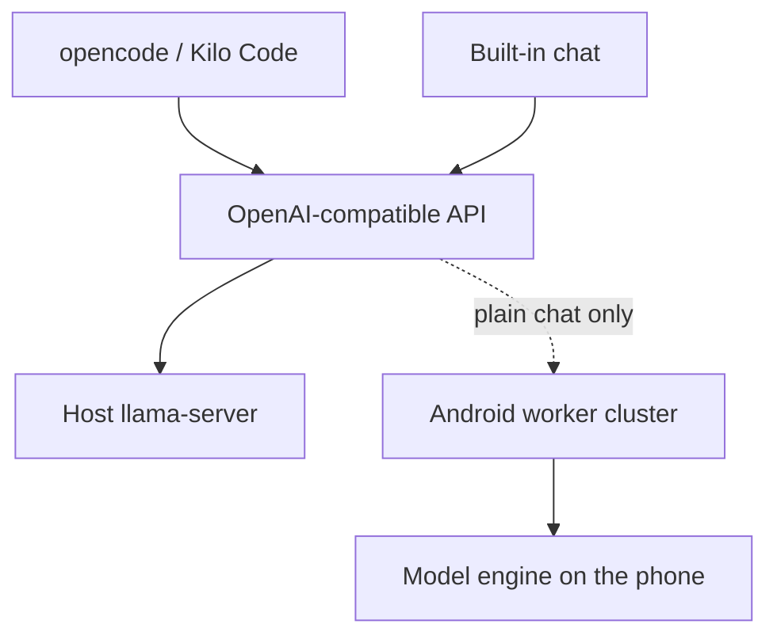

# AI Upcycler ♻️🤖

> **A local model server for coding agents, with a built-in chat and an optional pool of old Android phones.**

AI Upcycler runs a GGUF model on your own machine and exposes it through an
OpenAI-compatible endpoint. Point opencode, Kilo Code, or another chat-completions
client at `http://127.0.0.1:8080/v1` and the agent gets a private model with
tool calling. The same app keeps its own chat UI, and the Android worker can
serve a side-loaded model over the cluster path.

No account, no cloud, no API key on the loopback endpoint.

---

[](LICENSE)
[]()
[]()

## What works today

| Surface | State |
|---|---|
| **Agent endpoint** | OpenAI-compatible `tools` / `tool_calls`, buffered and streaming. Host engine only; the cluster stays plain chat. Code and tests are in place; a real-model and opencode run is still the next checkpoint. |
| **Built-in chat** | Buffered and streaming chat through the host `llama-server`, with a clearly labelled stub when no engine is present. |
| **Android worker** | Builds a debug APK, imports a side-loaded GGUF through the system picker, loads it, and serves the engine RPCs. No on-device run has been recorded yet. |
| **Cluster path** | Layer-split inference across paired Android workers over mTLS, with scheduler, telemetry, and thermal placement. Serves plain chat; distributed tool calling is not implemented. Real-device proof is pending. |
| **iOS worker** | Not started. Deferred until there is macOS + Xcode. |
| **Signing / auto-update** | Not implemented. The APK is debug-signed; installers are unsigned. |

The honest gap list, with the evidence that closes each item, is in
[`docs/launch-readiness.md`](./docs/launch-readiness.md). Hardware-gated items
stay unclaimed until they run on a real phone.

## Why

Coding agents usually send your code and prompts to a cloud provider. A local
model keeps the work on your machine. AI Upcycler gives the agent a standard
OpenAI surface, so the client does not need a special integration, and it keeps
the built-in chat for the times you just want to talk to the model.

The Android cluster is the second act: old phones contribute memory and compute
to a layer-split model. It is useful today for plain chat; tool calls stay on
the host until the worker renderer learns the tool format.

## Quickstart

### Prerequisites

- Rust 1.75+ and Cargo
- Node.js 20+ and pnpm
- The platform dependencies for Tauri v2
- For the Android worker: Android Studio or the Android SDK with `ANDROID_HOME`

### 1. Run the desktop app

```bash
git clone https://github.com/darshan192004/AI-upcycler.git
cd AI-upcycler
pnpm install
pnpm tauri dev
```

### 2. Give it a model

Chat runs on a labelled stub until a `llama-server` binary and a GGUF are
present. For real output:

1. Download a CPU build of [`llama.cpp`](https://github.com/ggml-org/llama.cpp/releases)
   (for example `llama-b*-bin-win-cpu-x64.zip`) and put `llama-server[.exe]`
   in `<app-data>/engine/`, or set `AI_UPCYCLER_LLAMA_SERVER` to the binary.
2. Put a GGUF in `<app-data>/models/`, or set `AI_UPCYCLER_MODEL`.
3. For a coding agent on an 8 GB host, use
   **Qwen2.5-Coder-3B-Instruct Q4_K_M** (about 1.9 GB). A 7B Q4 model needs
   about 16 GB of usable RAM.

The model library can live on another volume:

```powershell
$env:AI_UPCYCLER_MODELS_DIR = "D:\ai-upcycler\models"
$env:AI_UPCYCLER_MODEL = "D:\ai-upcycler\models\qwen2.5-coder-3b-instruct-q4_k_m.gguf"
```

See [`docs/agents.md`](./docs/agents.md) for the full environment table, the
engine discovery rule, and the opencode V2 provider block.

### 3. Point an agent at it

```text
Base URL: http://127.0.0.1:8080/v1
Model id: the id returned by GET /v1/models
```

A request carrying `tools` is served by the host engine and never by the
cluster. When no host engine exists, the API returns `400` instead of a text
answer that silently ignores the tools. The endpoint is loopback-only and has
no authentication; do not expose it.

### 4. Build the Android worker (optional)

```bash
cd mobile-worker/android
./gradlew :app:assembleDebug
```

Install the debug APK, open the Models screen, and import a GGUF through the
system document picker. The worker copies it into app-private storage and loads
it for the cluster path. The on-device checklist in
[`docs/tasks.md`](./docs/tasks.md) section 6 is still the gate for claiming it
works on a real phone.

## Architecture



The host engine serves tool requests. Plain chat can use the cluster when a
paired worker and a valid layer plan exist; `llama-server` is the fallback. The
choice is made per request before the first streamed byte.

## Documentation

- 🧑‍💻 [**Agent integration guide**](./docs/agents.md) - endpoint, model choice,
  opencode V2, host-only behavior, troubleshooting.
- 🔌 [**API reference**](./docs/api.md) - the OpenAI-compatible surface and the
  cluster management API.
- 🚦 [**Launch readiness**](./docs/launch-readiness.md) - what is done, what is
  hardware-gated, and what only the maintainer can decide.
- 📋 [**Task checklist**](./docs/tasks.md) - the implementation and on-device
  verification list.
- 🏗️ [**System architecture**](./docs/architecture.md) - topology, sequence
  diagrams, and module specs.
- 🔬 [**Technical specification**](./docs/spec.md) - layer slicing, RPC, and
  network structures.
- 🧠 [**Memory and storage**](./docs/memory.md) - mmap strategy and quantization.
- 🛡️ [**Security and threat model**](./docs/security.md) - local security, mTLS,
  and mobile sandboxing.
- 🗄️ [**Database and persistence**](./docs/database.md) - the SQLite schema.
- 📏 [**Code style**](./docs/code_style.md) - Rust, TypeScript, and Kotlin
  conventions.

## Contributing

Contributions are welcome. Read the code style guide, keep changes tested, and
open issues or pull requests against `main`. Hardware-gated claims need a
recorded run on the named device; more code is not a substitute.

## License

MIT. See [`LICENSE`](./LICENSE).
