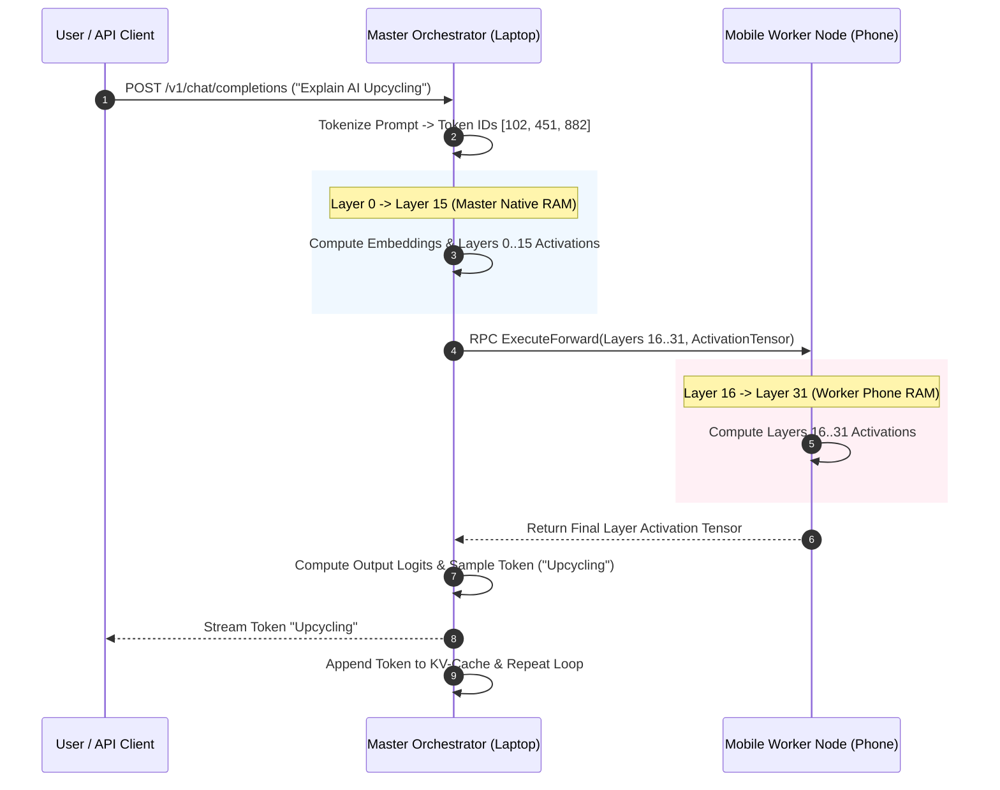
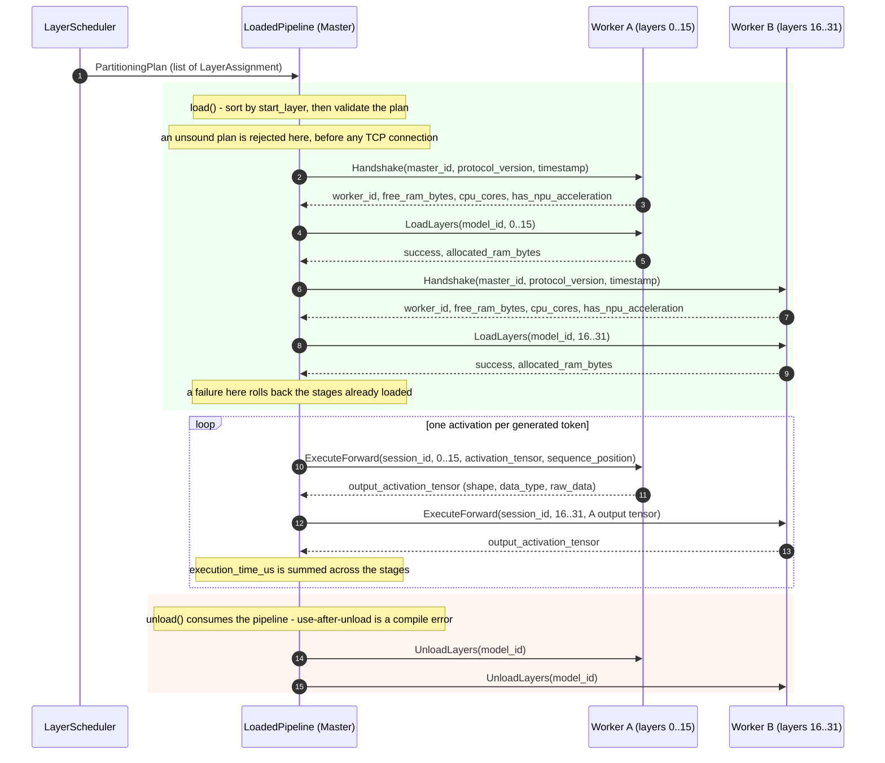

# System Architecture Specification - AI Upcycler

## 1. High-Level Architecture Overview

**AI Upcycler** follows a **Master-Worker Pipelined RPC Distributed Topology**. The system decouples model management, user interactions, and orchestration from raw tensor computation.

The host computer acts as the **Master Node (Brain)**, managing the UI, cluster auto-discovery, model partitioning, SSD `mmap` page eviction, and initial activation processing. Secondary devices (smartphones, tablets, old PCs) act as **Worker Nodes**, maintaining designated model layer weights in their local RAM and executing layer operations via an embedded RPC worker engine.

```mermaid
graph TB
    subgraph Master Node (Host Laptop)
        UI[Desktop GUI - React + Tailwind]
        TauriCore[Tauri Rust Bridge]
        MasterEngine[Orchestrator Core]
        Scheduler[Bandwidth-Aware Layer Slicing Scheduler]
        MmapPager[SSD mmap Memory Tiering Engine]
        DB[(SQLite Local Store)]

        UI <--> TauriCore
        TauriCore <--> MasterEngine
        MasterEngine <--> Scheduler
        MasterEngine <--> MmapPager
        MasterEngine <--> DB
    end

    subgraph Network Transport Layer
        Transport[mTLS / ProtoBuf RPC over TCP (Wi-Fi 6 / USB Tunnel)]
        MasterEngine <--> Transport
    end

    subgraph Worker Cluster (Distributed Nodes)
        Transport <--> Worker1[Android Node 1 - llama.cpp RPC Worker]
        Transport <--> Worker2[Android Node 2 - llama.cpp RPC Worker]
        Transport <--> Worker3[iOS Node 3 - Swift RPC Agent]
    end

    subgraph Storage Subsystem
        MmapPager <--> NVMe[Fast NVMe SSD GGUF Layer Storage]
    end
```

---

## 2. Core System Components

### 2.1 Master Node (Host Computer)

1. **Desktop GUI (React + TypeScript)**:
   - Provides visual cluster health metrics, device discovery controls, model catalog search, and prompt interface.
2. **Master Orchestrator Core (Rust)**:
   - Manages cluster state, triggers layer streaming, initiates RPC pipeline calls, and aggregates KV-cache tensors.
3. **Bandwidth-Aware Layer Scheduler**:
   - Analyzes hardware capabilities of all registered devices and solves a constrained optimization problem to assign model layers.
4. **SSD `mmap` Memory Tiering Engine**:
   - Handles host-side memory paging when the Master Node's designated layer count exceeds available physical RAM.

### 2.2 Worker Nodes (Mobile & Secondary Devices)

1. **Agent App (Android Kotlin / iOS Swift)**:
   - Lightweight wrapper handling device auto-discovery registration, background execution prevention, and battery/thermal telemetry.
2. **Embedded Native Worker Engine (`llama.cpp` RPC C++)**:
   - Compiled for ARM64-v8a with NEON / NPU hardware acceleration.
   - Listens on TCP port `50052` for binary tensor execution payloads.
   - Allocates contiguous RAM buffers for assigned layer weights and KV-cache blocks.

---

## 3. Distributed Pipelined Inference Sequence

The following sequence diagram details the token generation lifecycle across a 32-layer LLM split between the Master Node (Laptop) and a Mobile Worker Node.



### 3.1 Distributed Split Lifecycle: Load → Forward → Unload

The diagram above traces a single *token*. A **session** loads the cluster once and then
pushes many tokens through it. That is what `LoadedPipeline` (`core/src/rpc/engine.rs`)
implements, and it is verified device-free against two in-process mock workers in
`core/tests/distributed.rs` — each mock appends a unique tag byte to the activation it
receives, so the resulting byte order is proof the stages ran in ascending layer order.



The phases, precisely:

1. **Plan** — `LayerScheduler::compute_plan` produces the `LayerAssignment`s. Ranges are
   **inclusive** of both `start_layer` and `end_layer`, and the scheduler reserves 20% of
   each node's free RAM as head-room before assigning weights.
2. **Load** — `LoadedPipeline::load(model_id, &assignments)` sorts the assignments by
   `start_layer` and validates the plan (§3.1.1), then for each stage in order: connect →
   `Handshake` → `LoadLayers`. If a worker reports `success = false` the load aborts with
   that worker's `error_message`, and the stages already loaded are released via
   `UnloadLayers` so a partial load does not pin RAM on the cluster.
3. **Forward** — `LoadedPipeline::forward(payload)` threads **one** activation through
   every stage in ascending layer order via `ExecuteForward`, feeding each stage's output
   tensor into the next (§3.1.2), and sums each stage's `execution_time_us`. A worker
   returning `success = false` fails the whole forward.
4. **Unload** — `LoadedPipeline::unload(self)` **consumes** the pipeline, so using it after
   its workers have dropped the weights is a compile error. Every stage is released even if
   an earlier release failed; the first error is returned after the loop.

A session is deliberately distinct from `RpcPipelineEngine::dispatch_forward_step`, the
connectionless one-shot used by the desktop debug command: that connects, handshakes and
runs exactly one step, whereas `LoadedPipeline` keeps the workers loaded and connected
across many forward passes.

#### 3.1.1 Plan validity — the split contract

`load` validates the plan **before dialing any worker**, so an unsound split fails fast
(the tests assert the mock event log is still empty) instead of silently producing wrong
activations. A plan is rejected when it is:

| Rejected | Why it is unsound |
|---|---|
| empty | a pipeline with no stages would pass activations through unmodified |
| inverted (`start > end`) | the range is meaningless |
| not anchored at layer 0 | a plan partitions the model, so starting later silently skips the model head |
| overlapping (`next.start <= prev.end`) | those layers would execute twice |
| gapped (`next.start > prev.end + 1`) | those layers would be skipped |

The **tail is deliberately not checked**: the driver is not told how many layers the model
has, and `LayerScheduler::compute_plan` may legitimately return a plan that the available
cluster is too small to finish — it always starts at layer 0, but may stop short of the
last layer. `LoadedPipeline` is intentionally not `Debug`, so a load result cannot be
`expect_err`ed into a panic on the error path.

#### 3.1.2 Activation handoff

One `TensorBuffer` threads through the stages: `shape`, `data_type` and `raw_data`. The
driver carries each stage's **output** shape and dtype into the next stage rather than
assuming they are unchanged, so a stage may legally reshape or requantise the tensor.

Two fallbacks keep a silent worker from corrupting the pipeline: an empty output shape
falls back to the request's shape, and an unknown `data_type` falls back to the request's
dtype (`ActivationType`: `FP32 = 0`, `FP16 = 1`, `BF16 = 2`, matching
`TensorBuffer.DataType`). Both fallbacks are only correct for a shape- and
dtype-preserving stage, so a real engine must populate both fields rather than rely on
them.

#### 3.1.3 Wire contract

`proto/cluster_rpc.proto` (`aiupcycler.rpc.WorkerService`) is canonical; the Android worker
vendors a copy and its `checkProtoInSync` task fails the build on drift.

| RPC | Kind | Master side | Worker side |
|---|---|---|---|
| `Handshake` | metadata | used by `load` | live |
| `GetHealthStatus` | metadata | `WorkerRpcClient::health` | live |
| `LoadLayers` | compute | used by `load` | `UNIMPLEMENTED` |
| `ExecuteForward` | compute | used by `forward` | `UNIMPLEMENTED` |
| `UnloadLayers` | compute | used by `unload` and load rollback | `UNIMPLEMENTED` |

`LoadLayersRequest.weights_chunk_data` is left empty: weights are resolved worker-side for
now, and pushing a contiguous GGUF chunk is future work.

#### 3.1.4 What the worker engine must implement

The master half is done and mock-verified, so the remaining half is the engine. This is the
contract it must satisfy:

- **`LoadLayers`** — retain the weights for `[start_layer, end_layer]` of `model_id` (both
  bounds inclusive); return `success = false` with a human-readable `error_message` when it
  cannot, e.g. insufficient free RAM; report `allocated_ram_bytes`.
- **`ExecuteForward`** — run the owned range over the incoming activation and return the
  output tensor with **shape and dtype populated** (§3.1.2); return `success = false` to
  reject; report `execution_time_us`.
- **`UnloadLayers`** — free the RAM held for `model_id` and report `freed_ram_bytes`. It
  must tolerate being called for a model it never loaded: the driver unloads after a failed
  forward, and after a partial load it rolls back only the stages that succeeded.

Limits the driver applies to every call: 5 s to establish the connection
(`CONNECT_TIMEOUT`) and 30 s per RPC (`REQUEST_TIMEOUT`).

> **Transport gap.** `LoadedPipeline` currently dials workers with the plaintext `connect`
> (`http://<host>:<port>`), which is only acceptable on a loopback or ADB-tunneled link.
> The mTLS client (`WorkerRpcClient::connect_tls`, certificate pinning in
> `core/src/security.rs`, adversarial tests in `core/tests/mtls.rs`) exists but is **not yet
> wired into the split driver** — that belongs to the mTLS worker half (§5.1 of the plan).

---

## 4. Communication & Transport Layer

### 4.1 Discovery Protocol (mDNS / Zeroconf)
- Worker nodes broadcast service type `_aiupcycler-worker._tcp.local.` on port `50052`.
- TXT records include: `ram_free_mb`, `cpu_cores`, `os_type`, `api_version`.

### 4.2 USB Transport Adapter (ADB / USB Tethering)
- When Wi-Fi latency exceeds $15\text{ ms}$, the Master app prompts the user to connect via USB cable.
- Automatically executes `adb forward tcp:50052 tcp:50052` to achieve low latency ($\approx 1\text{ ms}$) and higher bandwidth ($480\text{ Mbps} - 5\text{ Gbps}$).

### 4.3 RPC Serialization Format
- High-efficiency binary serialization using Protocol Buffers (`cluster_rpc.proto`) with custom flat buffer tensor views to eliminate serialization copying overhead.

---

## 5. Fault Tolerance & Fallback Strategy

1. **Worker Disconnection during Inference**:
   - If a worker drops out (e.g. Wi-Fi packet loss or thermal throttling), the Master detects RPC timeout within $500\text{ ms}$.
   - The Master dynamically re-allocates the missing layers to host SSD `mmap` storage and resumes generation without resetting the session.
2. **Thermal & Battery Protection**:
   - Mobile workers transmit battery state and temperature telemetry.
   - If phone battery drops below $15\%$ or CPU temperature reaches $45^\circ\text{C}$, the scheduler migrates layers off the affected phone to prevent device degradation.
