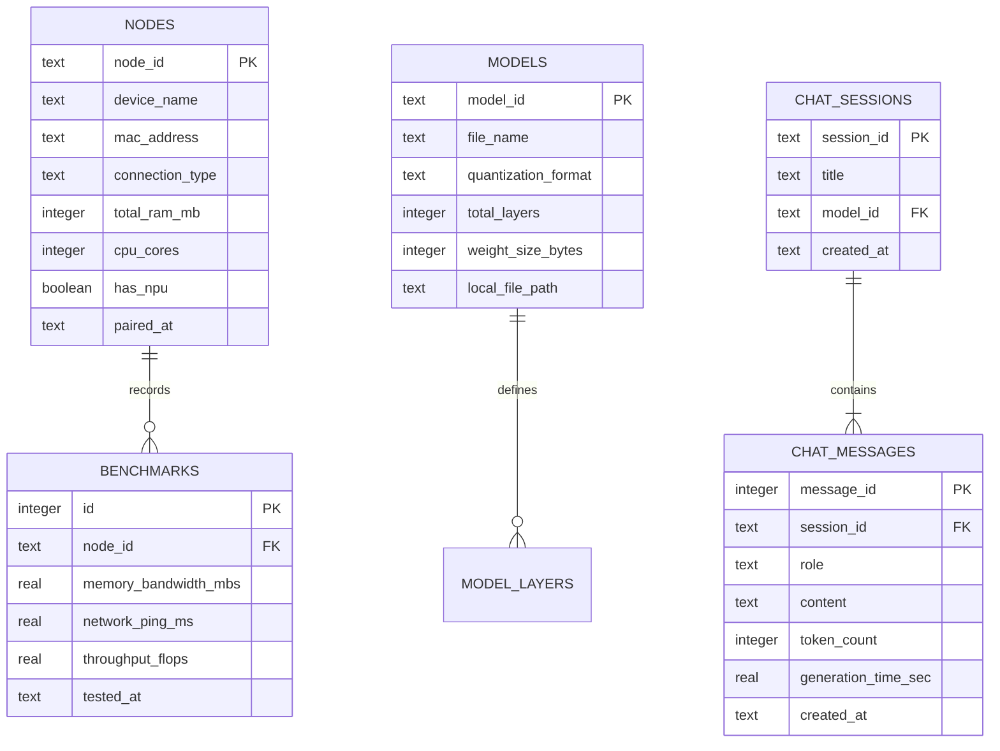

# Database & Persistence Specification - AI Upcycler

## 1. Overview

**AI Upcycler** uses an embedded **SQLite Database** (`aiupcycler.db`) managed by the host Master Node. It persists cluster topology profiles, registered device capabilities, Hugging Face GGUF model metadata, benchmark history, and local user chat logs.

---

## 2. Entity-Relationship (ER) Schema Diagram



---

## 3. SQL Data Definition Language (DDL) Schema

```sql
-- Registered Worker Nodes Table
CREATE TABLE IF NOT EXISTS nodes (
    node_id TEXT PRIMARY KEY,
    device_name TEXT NOT NULL,
    mac_address TEXT UNIQUE,
    connection_type TEXT NOT NULL, -- 'usb_adb', 'wifi_5g', 'native'
    total_ram_mb INTEGER NOT NULL,
    cpu_cores INTEGER NOT NULL,
    has_npu BOOLEAN DEFAULT 0,
    paired_at DATETIME DEFAULT CURRENT_TIMESTAMP
);

-- Historical Benchmark Logs
CREATE TABLE IF NOT EXISTS benchmarks (
    id INTEGER PRIMARY KEY AUTOINCREMENT,
    node_id TEXT NOT NULL,
    memory_bandwidth_mbs REAL NOT NULL,
    network_ping_ms REAL NOT NULL,
    throughput_flops REAL DEFAULT 0.0,
    tested_at DATETIME DEFAULT CURRENT_TIMESTAMP,
    FOREIGN KEY (node_id) REFERENCES nodes(node_id) ON DELETE CASCADE
);

-- Installed GGUF Model Registry
CREATE TABLE IF NOT EXISTS models (
    model_id TEXT PRIMARY KEY,
    file_name TEXT NOT NULL,
    quantization_format TEXT NOT NULL, -- 'Q4_K_M', 'Q3_K_M', 'IQ2_XS'
    total_layers INTEGER NOT NULL,
    weight_size_bytes INTEGER NOT NULL,
    local_file_path TEXT NOT NULL,
    added_at DATETIME DEFAULT CURRENT_TIMESTAMP
);

-- Chat Sessions
CREATE TABLE IF NOT EXISTS chat_sessions (
    session_id TEXT PRIMARY KEY,
    title TEXT NOT NULL,
    model_id TEXT NOT NULL,
    created_at DATETIME DEFAULT CURRENT_TIMESTAMP,
    FOREIGN KEY (model_id) REFERENCES models(model_id)
);

-- Chat Messages
CREATE TABLE IF NOT EXISTS chat_messages (
    message_id INTEGER PRIMARY KEY AUTOINCREMENT,
    session_id TEXT NOT NULL,
    role TEXT NOT NULL, -- 'system', 'user', 'assistant'
    content TEXT NOT NULL,
    token_count INTEGER DEFAULT 0,
    generation_time_sec REAL DEFAULT 0.0,
    created_at DATETIME DEFAULT CURRENT_TIMESTAMP,
    FOREIGN KEY (session_id) REFERENCES chat_sessions(session_id) ON DELETE CASCADE
);
```
