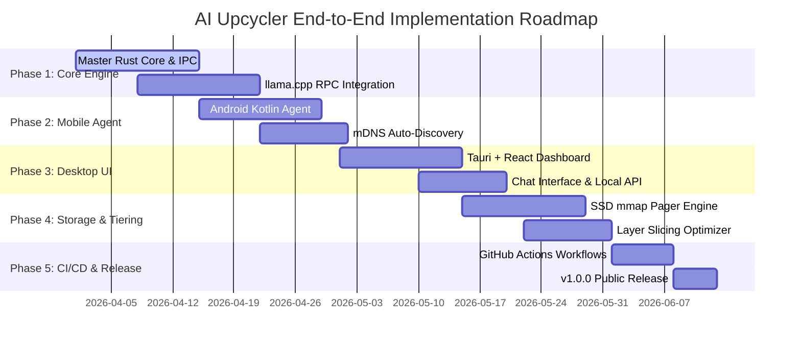

# End-to-End Implementation, Testing & CI/CD Plan - AI Upcycler

## 1. Roadmap & Phase Breakdown



---

## 2. Phase-by-Phase Technical Tasks

### Phase 1: Master Orchestrator Core & RPC Engine
- Initialize Tauri + Rust project architecture.
- Compile native `llama.cpp` RPC server bindings for host Windows/Linux/macOS platforms.
- Implement Protocol Buffer RPC client handlers for worker node connection.

### Phase 2: Worker Mobile Agents & Auto-Discovery
- Create Android Kotlin worker application wrapping native C++ `llama.cpp` RPC binaries.
- Implement mDNS / DNS-SD service broadcasting (`_aiupcycler-worker._tcp.local.`).
- Implement ADB USB port forwarding bridge (`adb forward tcp:50052 tcp:50052`).

### Phase 3: Master Desktop UI & OpenAI-Compatible REST API
- Build React + Tailwind glassmorphic dashboard with live telemetry canvas.
- Implement streaming chat interface connecting to `/v1/chat/completions`.
- Create GGUF model downloader integrating Hugging Face hub API.

### Phase 4: SSD Memory Mapping (`mmap`) & Layer Scheduler
- Implement POSIX `mmap` / Windows `CreateFileMapping` layer pager.
- Develop dynamic programming scheduler to solve layer distribution optimization.
- Add host RAM buffer safety guardrails preventing OS OOM crashes.

---

## 3. Automated CI/CD Pipelines (GitHub Actions)

To ensure that anyone can directly download and install the executable (`.exe`) file whenever a new version is released or a branch merges into `main`, AI Upcycler utilizes GitHub Actions workflows.

### 3.1 Release Workflow (`.github/workflows/release.yml`)

The release workflow builds the Tauri desktop app on a **Windows / macOS / Linux** matrix and attaches the installers to a GitHub Release. It is triggered by pushing a version tag (`v*`) or via manual `workflow_dispatch`. The tag is derived from the app version (`v__VERSION__`), so bump the version (e.g. in `src-tauri/tauri.conf.json`) before tagging. Merges to `main` are validated by `.github/workflows/ci.yml` instead of triggering a release.

```yaml
name: Release Build (Windows, macOS, Linux)

on:
  push:
    tags:
      - 'v*'
  workflow_dispatch:

jobs:
  publish-tauri:
    strategy:
      fail-fast: false
      matrix:
        include:
          - platform: 'macos-latest'          # universal .dmg / .app
          - platform: 'ubuntu-22.04'          # .deb / .rpm / .AppImage
          - platform: 'windows-latest'        # .msi / .exe
    runs-on: ${{ matrix.platform }}
    steps:
      # ... pnpm + node + rust setup, Linux webkit2gtk-4.1 deps, then:
      - uses: tauri-apps/tauri-action@v0
        with:
          tagName: v__VERSION__
          releaseName: 'AI Upcycler v__VERSION__'
```

> [!NOTE]
> Packaging the Android `.apk` worker asset ships from its own `release.yml` job (`publish-android-apk`, PR #71): it builds the side-loadable debug APK with the `android-worker` recipe, publishes the `worker-apk` artifact on every run, and attaches `aiupcycler-worker-<tag>-debug.apk` to tag releases created by the desktop matrix.

---

## 4. Verification & Testing Strategy

### 4.1 Unit & Integration Testing
- **Scheduler Unit Tests**: Verify layer assignment logic against various device RAM configs ($8\text{GB} + 4\text{GB} + 4\text{GB}$).
- **mmap Boundary Tests**: Test loading 16GB model files on an 8GB RAM host machine to ensure zero OOM crashes.

### 4.2 Hardware Benchmark & Network Simulation Tests
- **Latency Emulation**: Test RPC throughput under simulated Wi-Fi packet drops ($5\%$ loss) and latency spikes ($50\text{ ms}$).
- **Thermal Load Test**: Measure mobile worker temperature over a 1000-token continuous generation run.

---

## 5. Progress Status

Legend: ✅ done · 🟡 partial · ⬜ not started

| Phase | Item | Status |
|-------|------|--------|
| 1 | Tauri 2.0 shell + pure-Rust `ai-upcycler-core` workspace | ✅ |
| 1 | Protobuf RPC client (`cluster_rpc.proto`) | ✅ |
| 1 | Native `llama.cpp` RPC worker bindings (host) | ⬜ |
| 2 | mDNS / DNS-SD discovery (`_aiupcycler-worker._tcp.local.`) | ✅ |
| 2 | ADB USB port-forward bridge | ✅ |
| 2 | Android Kotlin worker app (debug APK; discovery + metadata + compute RPCs; pure-Kotlin engine port; mTLS serving + phone pairing screen; contract-tested device-free) | 🟡 |
| 3 | OpenAI-compatible REST API (`/v1/models`, `/v1/chat/completions` + SSE) | ✅ |
| 3 | Cluster topology + benchmark endpoints | ✅ |
| 3 | Telemetry WebSocket fan-out (`/api/telemetry`) | ✅ |
| 3 | Embedded SQLite store (nodes, models, benchmarks, chat) | ✅ |
| 3 | React dashboard wired to live data (telemetry canvas) | ✅ |
| 3 | Streaming chat UI + GGUF / Hugging Face downloader | ✅ |
| 4 | Dynamic-programming layer scheduler (+ 20% host RAM headroom) | ✅ |
| 4 | SSD `mmap` zero-copy weight pager | ✅ |
| 5 | CI (fmt/clippy/test, desktop shell, frontend) | ✅ |
| 5 | Release workflow (Windows/macOS/Linux installers on tag) | ✅ |
| 5 | Android `.apk` release asset | ✅ |

**Completed: 15 / 17 tracked items, 1 partial.** The Android worker app now builds a real debug APK (`mobile-worker/android/`, CI job `android-worker`), serves the discovery + metadata RPCs (`Handshake`, `GetHealthStatus`) from a foreground service so it survives backgrounding, and has its wire contract covered by a device-free in-process gRPC test. Its compute RPCs are wired too: a pure-Kotlin engine port (GGUF parse, dequant, forward parity against Rust-cut vectors at the D-A2 bar) serves `LoadLayers`/`ExecuteForward`/`UnloadLayers` through `EngineSource`, answering the honest `UNIMPLEMENTED` only when no engine is loaded (spec D-A4, PRs #66–#70); once paired, the worker serves that RPC behind mTLS (#76) and pairs from the phone's own screen (#77). The **host-side distributed split driver** now runs end-to-end: `LoadedPipeline` (`core/src/rpc/engine.rs`) connects and handshakes with each worker, issues `LoadLayers`, threads one activation through every stage in layer order via `ExecuteForward`, and releases the cluster with `UnloadLayers` — including load rollback on a partial failure. It is verified device-free against in-process mock workers in `core/tests/distributed.rs`, and it validates the plan before dialing any worker — inverted, overlapping or gapped layer ranges, or a plan that does not begin at layer 0, are rejected rather than silently duplicating or skipping layers. The driver also has no plaintext fallback: `LoadedPipeline::load_secure` dials each worker with the transport its credential source resolves (mTLS, with the worker's certificate pinned to the cluster CA) and resolves every transport before the first dial. Pairing provisions both directions of that link: enrollment issues the worker a `ServerAuth` certificate whose SANs are the addresses it declared, plus its `ClientAuth` one, and the master holds its own `ClientAuth` identity — so `EnrolledWorkerSource` resolves a transport only for a worker that completed pairing and the whole loop (enroll over the HTTP API → serve the certificate that was issued → drive it over mTLS) is covered device-free in `core/tests/api.rs`. Detailed, continuously-updated tracking lives in [`tasks.md`](./tasks.md). The load → forward → unload session lifecycle — plan-validity rules, activation handoff, the wire contract and what the worker engine must implement — is written up in [`architecture.md`](./architecture.md) §3.1.

### 5.1 Remaining work & blockers

| Item | Blocked on |
|------|------------|
| ~~Native `llama.cpp` RPC worker bindings (host) for the distributed cluster split~~ **RESOLVED (2026-10-17)** — shipped as the pure-Rust `worker/` crate instead of C++ bindings: real GGUF layer-range loading, qwen2 block math, `Handshake`/`GetHealthStatus`/`LoadLayers`/`ExecuteForward`/`UnloadLayers` all live; logits parity vs `llama-server` on the real quantized Qwen2.5-0.5B (greedy argmax exact) and split-equivalence over real worker processes (PRs #41/#42/#53, epic spec: `docs/superpowers/specs/2026-10-16-worker-engine-design.md`, implementation notes: `docs/superpowers/plans/2026-10-16-worker-engine.md`) |
| ~~Android worker compute engine: native `llama.cpp` RPC server for ARM64~~ **superseded by the pure-Kotlin port, landed device-free (2026-10-19)** — no NDK needed: `LoadLayers`/`ExecuteForward`/`UnloadLayers` are served through `EngineSource` (PRs #66/#67/#68/#70) with K-quant goldens, forward parity against Rust-cut vectors at ≤1e-5 relative, the refusal matrix and a full split lifecycle over in-process gRPC (`WorkerRpcContractTest`); the master side it satisfies is exercised by `core/tests/distributed.rs` | On-device verification: a physical Android device (tasks.md §6 checklist) |
| iOS Swift agent | Same — needs a macOS/Xcode toolchain |
| mTLS worker half (Android mTLS server, QR display, fingerprint trust) | **All slices landed device-free (2026-10-18…21)**: the master side is complete (both worker identities + the master's `ClientAuth`, `EnrolledWorkerSource` with no plaintext fallback — now wired in production through the live chat path's `AdaptiveBackend`); pairing-only listener + `adb reverse` (#73); enrollment client + credential store (#74); worker mTLS serving behind issued credentials (`WorkerTls.kt`, #76); phone pairing screen with distinct payload-vs-prefix verification (#77); dashboard `prepare_pairing` + `PairingPanel` (QR, PIN, copy-URI) with the reverse tunnel retired when its session completes or expires (D-B8, this PR). Remaining: the live on-device run — hardware-gated (tasks.md §6 checklist) |
| ~~`.apk` release asset~~ **RESOLVED (2026-10-19)** — `release.yml` gained the `publish-android-apk` job (PR #71): builds the side-loadable debug APK with the `android-worker` recipe, publishes the `worker-apk` workflow artifact on every run, and attaches `aiupcycler-worker-<tag>-debug.apk` to tag releases | — |
| ~~On-device benchmark probes (replace `StubBenchmarker`)~~ **RESOLVED device-free (2026-10-21)** — spec `docs/superpowers/specs/2026-10-21-hardware-benchmark-probes-design.md`; the endpoint now probes each node over the transport it serves on (mTLS when enrolled, plaintext otherwise), against an additive `Benchmark` RPC answered by bounded self-probes in both the Rust worker (`worker/src/probe.rs`) and the Kotlin worker (`HardwareProbe.kt`); failures and pre-probe `UNIMPLEMENTED` workers are counted in `nodes_failed` with no row written, and `StubBenchmarker` is `#[cfg(test)]`-only. Proven end-to-end against the real Rust worker binary with real host measurements | Real phone bandwidth/FLOP **values** are hardware-gated (tasks.md §6 checklist); nothing consumes the rows yet |
| §4.2 / §6 end-to-end hardware tests | Needs a physical 8 GB host + 2× Android cluster |

> Stubbed-but-wired: the **host** chat path runs a real llama.cpp `llama-server` behind `GenerationBackend` (streaming, SQLite persistence and telemetry are all live), with the deterministic `StubBackend` as the honest fallback when no model/server is present. `POST /api/cluster/benchmark` now records values the worker **measured itself** over the `Benchmark` RPC (see the resolved row above); a node that cannot answer is counted in `nodes_failed`, not faked. Both sit behind traits (`GenerationBackend`, `HardwareBenchmarker`) so the real engines drop in without API changes.

