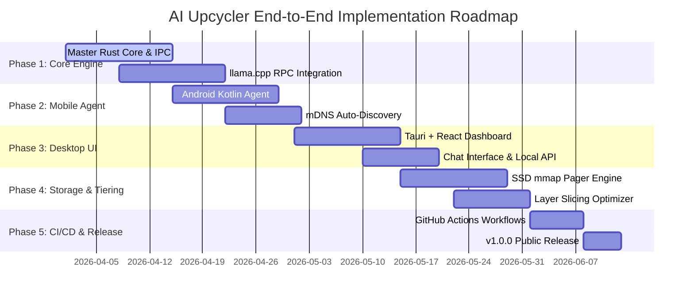

# End-to-End Implementation, Testing & CI/CD Plan - AI Upcycler

## 1. Roadmap & Phase Breakdown



---

## 2. Phase-by-Phase Technical Tasks

### Phase 1: Master Orchestrator Core & RPC Engine
- Initialize Tauri + Rust project architecture.
- Compile native `llama.cpp` RPC server bindings for host Windows/Linux/macOS platforms.
- Implement Protocol Buffer RPC client handlers for worker node connection.

### Phase 2: Worker Mobile Agents & Auto-Discovery
- Create Android Kotlin worker application wrapping native C++ `llama.cpp` RPC binaries.
- Implement mDNS / DNS-SD service broadcasting (`_aiupcycler-worker._tcp.local.`).
- Implement ADB USB port forwarding bridge (`adb forward tcp:50052 tcp:50052`).

### Phase 3: Master Desktop UI & OpenAI-Compatible REST API
- Build React + Tailwind glassmorphic dashboard with live telemetry canvas.
- Implement streaming chat interface connecting to `/v1/chat/completions`.
- Create GGUF model downloader integrating Hugging Face hub API.

### Phase 4: SSD Memory Mapping (`mmap`) & Layer Scheduler
- Implement POSIX `mmap` / Windows `CreateFileMapping` layer pager.
- Develop dynamic programming scheduler to solve layer distribution optimization.
- Add host RAM buffer safety guardrails preventing OS OOM crashes.

---

## 3. Automated CI/CD Pipelines (GitHub Actions)

To ensure that anyone can directly download and install the executable (`.exe`) file whenever a new version is released or a branch merges into `main`, AI Upcycler utilizes GitHub Actions workflows.

### 3.1 Release Workflow (`.github/workflows/release.yml`)

The release workflow builds the Tauri desktop app on a **Windows / macOS / Linux** matrix and attaches the installers to a GitHub Release. It is triggered by pushing a version tag (`v*`) or via manual `workflow_dispatch`. The tag is derived from the app version (`v__VERSION__`), so bump the version (e.g. in `src-tauri/tauri.conf.json`) before tagging. Merges to `main` are validated by `.github/workflows/ci.yml` instead of triggering a release.

```yaml
name: Release Build (Windows, macOS, Linux)

on:
  push:
    tags:
      - 'v*'
  workflow_dispatch:

jobs:
  publish-tauri:
    strategy:
      fail-fast: false
      matrix:
        include:
          - platform: 'macos-latest'          # universal .dmg / .app
          - platform: 'ubuntu-22.04'          # .deb / .rpm / .AppImage
          - platform: 'windows-latest'        # .msi / .exe
    runs-on: ${{ matrix.platform }}
    steps:
      # ... pnpm + node + rust setup, Linux webkit2gtk-4.1 deps, then:
      - uses: tauri-apps/tauri-action@v0
        with:
          tagName: v__VERSION__
          releaseName: 'AI Upcycler v__VERSION__'
```

> [!NOTE]
> Packaging the Android `.apk` worker asset is not yet part of this workflow; it is tracked in `tasks.md` and depends on the Android worker agent (section 5).

---

## 4. Verification & Testing Strategy

### 4.1 Unit & Integration Testing
- **Scheduler Unit Tests**: Verify layer assignment logic against various device RAM configs ($8\text{GB} + 4\text{GB} + 4\text{GB}$).
- **mmap Boundary Tests**: Test loading 16GB model files on an 8GB RAM host machine to ensure zero OOM crashes.

### 4.2 Hardware Benchmark & Network Simulation Tests
- **Latency Emulation**: Test RPC throughput under simulated Wi-Fi packet drops ($5\%$ loss) and latency spikes ($50\text{ ms}$).
- **Thermal Load Test**: Measure mobile worker temperature over a 1000-token continuous generation run.

---

## 5. Progress Status

Legend: ✅ done · 🟡 partial · ⬜ not started

| Phase | Item | Status |
|-------|------|--------|
| 1 | Tauri 2.0 shell + pure-Rust `ai-upcycler-core` workspace | ✅ |
| 1 | Protobuf RPC client (`cluster_rpc.proto`) | ✅ |
| 1 | Native `llama.cpp` RPC worker bindings (host) | ⬜ |
| 2 | mDNS / DNS-SD discovery (`_aiupcycler-worker._tcp.local.`) | ✅ |
| 2 | ADB USB port-forward bridge | ✅ |
| 2 | Android Kotlin worker app (+ `.apk` packaging) | ⬜ |
| 3 | OpenAI-compatible REST API (`/v1/models`, `/v1/chat/completions` + SSE) | ✅ |
| 3 | Cluster topology + benchmark endpoints | ✅ |
| 3 | Telemetry WebSocket fan-out (`/api/telemetry`) | ✅ |
| 3 | Embedded SQLite store (nodes, models, benchmarks, chat) | ✅ |
| 3 | React dashboard wired to live data (telemetry canvas) | ✅ |
| 3 | Streaming chat UI + GGUF / Hugging Face downloader | ✅ |
| 4 | Dynamic-programming layer scheduler (+ 20% host RAM headroom) | ✅ |
| 4 | SSD `mmap` zero-copy weight pager | ✅ |
| 5 | CI (fmt/clippy/test, desktop shell, frontend) | ✅ |
| 5 | Release workflow (Windows/macOS/Linux installers on tag) | ✅ |
| 5 | Android `.apk` release asset | ⬜ |

**Completed: 14 / 17 tracked items.** Detailed, continuously-updated tracking lives in [`tasks.md`](./tasks.md). Host-side real inference (llama.cpp `llama-server` behind `GenerationBackend`) is live; the remaining unbuilt rows need physical Android hardware, an Android SDK/NDK toolchain, and host `llama.cpp` RPC bindings for the cluster split. Deliberately deferred work (mTLS/pairing, on-device benchmark probes) is listed under *Known Gaps* there.

> Stubbed-but-wired: the chat path runs an end-to-end streaming/persistence/telemetry pipeline against a placeholder `StubBackend`, and `POST /api/cluster/benchmark` uses a deterministic `StubBenchmarker`. Both sit behind traits (`GenerationBackend`, `HardwareBenchmarker`) so the real engines drop in without API changes.

