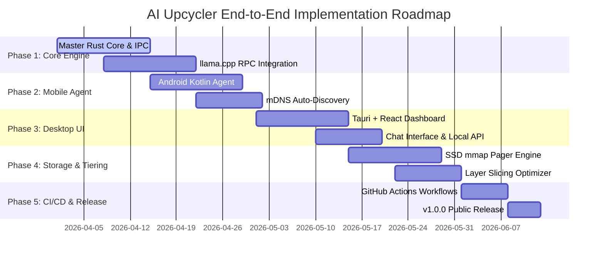

# End-to-End Implementation, Testing & CI/CD Plan - AI Upcycler

## 1. Roadmap & Phase Breakdown



---

## 2. Phase-by-Phase Technical Tasks

### Phase 1: Master Orchestrator Core & RPC Engine
- Initialize Tauri + Rust project architecture.
- Compile native `llama.cpp` RPC server bindings for host Windows/Linux/macOS platforms.
- Implement Protocol Buffer RPC client handlers for worker node connection.

### Phase 2: Worker Mobile Agents & Auto-Discovery
- Create Android Kotlin worker application wrapping native C++ `llama.cpp` RPC binaries.
- Implement mDNS / DNS-SD service broadcasting (`_aiupcycler-worker._tcp.local.`).
- Implement ADB USB port forwarding bridge (`adb forward tcp:50052 tcp:50052`).

### Phase 3: Master Desktop UI & OpenAI-Compatible REST API
- Build React + Tailwind glassmorphic dashboard with live telemetry canvas.
- Implement streaming chat interface connecting to `/v1/chat/completions`.
- Create GGUF model downloader integrating Hugging Face hub API.

### Phase 4: SSD Memory Mapping (`mmap`) & Layer Scheduler
- Implement POSIX `mmap` / Windows `CreateFileMapping` layer pager.
- Develop dynamic programming scheduler to solve layer distribution optimization.
- Add host RAM buffer safety guardrails preventing OS OOM crashes.

---

## 3. Automated CI/CD Pipelines (GitHub Actions)

To ensure that anyone can directly download and install the executable (`.exe`) file whenever a new version is released or a branch merges into `main`, AI Upcycler utilizes GitHub Actions workflows.

### 3.1 Release Workflow (`.github/workflows/release.yml`)

This workflow automatically builds the Windows `.exe` installer (via Tauri), packages the Android `.apk` worker app, and attaches them to a new GitHub Release whenever code is merged into `main` or a version tag (`v*`) is pushed.

```yaml
name: Automated Release Build (Windows .exe & Android .apk)

on:
  push:
    branches:
      - main
    tags:
      - 'v*'

jobs:
  build-windows-exe:
    name: Build Windows Desktop Installer (.exe)
    runs-on: windows-latest
    steps:
      - name: Checkout Code
        uses: actions/checkout@v4

      - name: Setup Node.js & pnpm
        uses: pnpm/action-setup@v2
        with:
          version: 8

      - name: Setup Rust Toolchain
        uses: dtolnay/rust-toolchain@stable
        with:
          targets: x86_64-pc-windows-msvc

      - name: Install Frontend Dependencies
        run: pnpm install

      - name: Build Tauri Desktop Executable (.exe)
        uses: tauri-apps/tauri-action@v0
        env:
          GITHUB_TOKEN: ${{ secrets.GITHUB_TOKEN }}
        with:
          tagName: v__VERSION__
          releaseName: 'AI Upcycler v__VERSION__'
          releaseBody: 'Automated release generated by GitHub Actions on merge to main.'
          releaseDraft: false
          prerelease: false

  build-android-apk:
    name: Build Android Worker APK (.apk)
    runs-on: ubuntu-latest
    steps:
      - name: Checkout Code
        uses: actions/checkout@v4

      - name: Set up JDK 17
        uses: actions/setup-java@v3
        with:
          java-version: '17'
          distribution: 'temurin'

      - name: Build Android APK
        run: |
          cd mobile-worker/android
          ./gradlew assembleRelease

      - name: Upload APK Artifact
        uses: actions/upload-artifact@v4
        with:
          name: AI-Upcycler-Worker-Android.apk
          path: mobile-worker/android/app/build/outputs/apk/release/app-release.apk
```

---

## 4. Verification & Testing Strategy

### 4.1 Unit & Integration Testing
- **Scheduler Unit Tests**: Verify layer assignment logic against various device RAM configs ($8\text{GB} + 4\text{GB} + 4\text{GB}$).
- **mmap Boundary Tests**: Test loading 16GB model files on an 8GB RAM host machine to ensure zero OOM crashes.

### 4.2 Hardware Benchmark & Network Simulation Tests
- **Latency Emulation**: Test RPC throughput under simulated Wi-Fi packet drops ($5\%$ loss) and latency spikes ($50\text{ ms}$).
- **Thermal Load Test**: Measure mobile worker temperature over a 1000-token continuous generation run.
