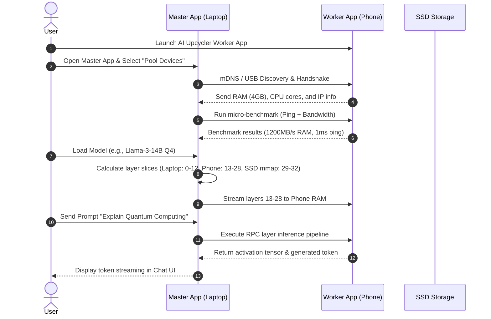

# Product Requirements Document (PRD) - AI Upcycler

## 1. Executive Summary & Vision

**AI Upcycler** is an open-source hardware-pooling software suite designed to democratize AI execution by upcycling obsolete consumer electronics (old smartphones, tablets, external SSDs, and HDDs). It aggregates fragmented compute, RAM, and storage resources across devices into a unified, high-efficiency local cluster capable of running Large Language Models (LLMs) up to 70 Billion parameters on modest consumer host hardware (e.g. an 8GB RAM laptop).

---

## 2. Problem Statement & Market Context

### The Challenge
1. **Hardware Cost Barrier**: Running state-of-the-art open-weights LLMs (14B–70B parameters) requires expensive dedicated GPUs or high-memory Apple Silicon hardware ($2,000–$5,000+).
2. **E-Waste Crisis**: Billions of smartphones and storage drives are discarded or sit unused in households globally every year. These devices possess capable ARM CPUs/NPUs and 3GB–6GB of high-speed LPDDR4/5 RAM.
3. **Physical Hardware Bottlenecks**: Directly wiring phone flash storage or HDDs as raw physical PC system RAM fails due to memory bus speed and PCIe latency limitations.

### The Solution
AI Upcycler introduces a software orchestration layer that uses **Pipelined RPC Distributed Inference** across pooled mobile devices and **Tiered `mmap` Memory Mapping** on fast SSDs. Users connect their old devices over Wi-Fi or USB tethering, click "Pool Devices", and instantly expand their host PC's AI memory and compute capacity.

---

## 3. Target User Personas

1. **The Resourceful Student / Researcher**: Has an entry-level 8GB RAM laptop, zero budget for cloud API credits or expensive GPUs, but owns 2-3 older family Android phones.
2. **The Open-Source AI Enthusiast**: Wants to experiment with 14B–32B models locally with total data privacy.
3. **The Sustainability Advocate / E-Waste Collector**: Passionate about upcycling retired hardware into functional compute infrastructure.

---

## 4. Key Product Capabilities & Requirements

### 4.1 Functional Requirements (FR)

- **FR-1: One-Click Cluster Auto-Discovery**:
  - Automatically detect worker nodes on the local Wi-Fi network using mDNS (Multicast DNS).
  - Automatically detect devices plugged in via USB (using ADB port forwarding or USB network tethering).
- **FR-2: Dynamic Hardware Benchmarking**:
  - Measure memory bandwidth, available RAM, network ping, and compute throughput ($TFLOPs$) of each discovered worker upon pairing.
- **FR-3: Automated Layer Slicing & Scheduling**:
  - Compute the optimal model layer split across the Master node and worker devices based on model weight size ($M$), layer count ($L$), device RAM ($R_i$), and network latency ($\tau_i$).
- **FR-4: SSD Memory Mapping (`mmap`) & Tiering**:
  - Offload unassigned layers to local NVMe/SATA SSDs via zero-copy `mmap` with intelligent page eviction.
- **FR-5: Model Downloader & Manager**:
  - Built-in search and download interface for Hugging Face GGUF models (supporting Q2_K through Q6_K quantization).
- **FR-6: Interactive Local Chat UI & API**:
  - Built-in ChatGPT-style desktop chat client and an OpenAI-compatible HTTP REST API endpoint (`/v1/chat/completions`) for integration with third-party apps (e.g. Open WebUI, Cursor, Obsidian).

### 4.2 Non-Functional Requirements (NFR)

- **NFR-1: Performance**: Achieve $\ge 5 \text{ tokens/second}$ generation speed on a pooled cluster consisting of an 8GB laptop and two 4GB Android phones running a 14B Q4 model over USB tethering.
- **NFR-2: Memory Safety & Crash Prevention**: Prevent Out-Of-Memory (OOM) host OS crashes by enforcing hard RAM buffer reservations ($1.5\text{ GB}$ minimum host system overhead).
- **NFR-3: Security & Data Privacy**: 100% local processing; all inter-device communications encrypted via TLS 1.3 with self-signed certificate pairing.
- **NFR-4: Cross-Platform Support**:
  - **Master Control App**: Windows 10/11, macOS 12+, Linux (x86_64 / ARM64).
  - **Worker Agent**: Android 8.0+ (ARMv8-A), iOS 14+ (ARM64).

---

## 5. User Journey & Workflow

---

## 6. Release Scope & MVP Roadmap

### Milestone 1: MVP (v0.1.0)
- Desktop Master app (Tauri + Rust) supporting Windows/macOS.
- Android Worker app embedding C++ `llama.cpp` RPC worker binaries over Wi-Fi.
- Automated layer allocation for 8B and 14B GGUF models.
- Built-in chat interface & standard REST API.

### Milestone 2: Hardware Optimization (v0.2.0)
- USB tethering / ADB port forwarding auto-tunneling for low-latency wired RPC.
- NVMe SSD `mmap` pager for handling remaining model layers.
- Benchmark profiling dashboard.

### Milestone 3: Open-Source Ecosystem (v1.0.0)
- iOS worker client release.
- WebGPU worker agent in mobile browser.
- Open-source cluster management plugin framework.
