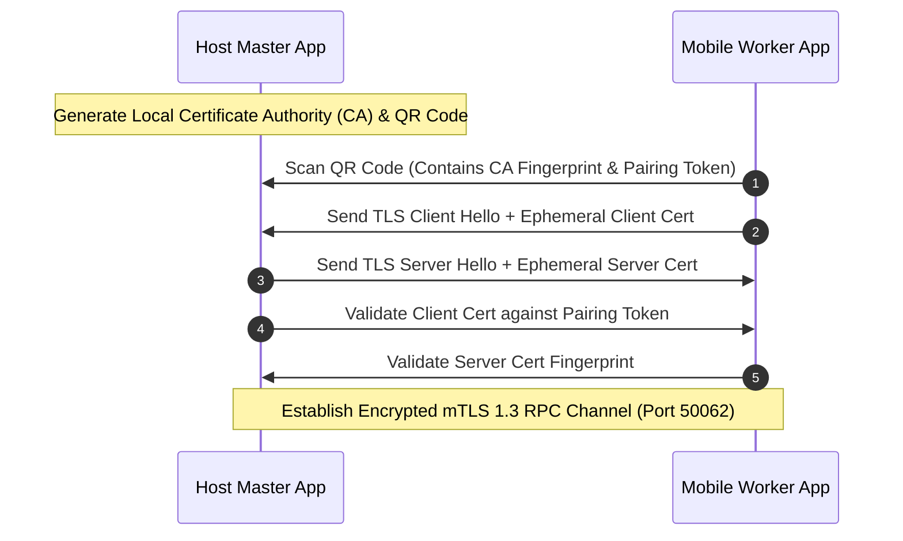

# Security & Threat Model Specification - AI Upcycler

## 1. Security Overview & Philosophy

**AI Upcycler** keeps prompt contents, activation tensors, and generated outputs on the host or on paired devices. Two API boundaries matter: loopback `127.0.0.1:8080` is unauthenticated and relies on the OS account and browser-origin rules (`docs/api.md` §5); the opt-in LAN listener (§5 below) is bearer-authenticated and off by default. Inter-node RPC transport and local worker sandboxes are separate boundaries.

---

## 2. Threat Matrix & Mitigation Strategies

| Threat Vector | Severity | Attack Scenario | Mitigation Strategy |
|---|---|---|---|
| **Local Wi-Fi Eavesdropping** | High | An attacker on the same Wi-Fi network sniffs RPC packets to reconstruct prompt text or tokens. | **mTLS 1.3 Transport Encryption**: All inter-node RPC connections require mutual TLS authentication using ephemeral self-signed certificates. |
| **Rogue Worker Injection** | Medium | A rogue device on the local network registers as a worker node to inject malicious activations or corrupt model outputs. | **Pairing Pin / QR Code Auth**: Pairing requires entering a 6-digit PIN or scanning a cryptographically signed QR code generated by the Master App. |
| **Mobile Device Exploit / Arbitrary Code Execution** | Critical | Malicious model weights or malformed RPC payloads attempt buffer overflows inside the mobile `llama.cpp` RPC C++ runner. | **Mobile App Sandboxing**: Embedded RPC binaries run inside standard Android NDK / iOS App sandboxes without root privileges. Standard size validation on incoming tensor buffers. |
| **Host System Memory Exhaustion (OOM)** | High | Unbounded tensor allocation leads to host kernel panic or browser crash. | **Hard RAM Reservation Guardrails**: Pre-allocates fixed memory pools; rejects layer loading requests exceeding system bounds. |
| **LAN API discovery and token guessing** | High | A device on the same Wi-Fi browses the mDNS advert or guesses the listener port and calls the phone chat API. | **Opt-in allowlist plus bearer token**: off unless `AI_UPCYCLER_LAN_API=1`; hash-only host storage, constant-time verification, fixed `401`, no token in mDNS TXT records or logs; revoke on unpair and rotate on CA replacement (§5). |

---

## 3. Mutual TLS (mTLS) Authentication Sequence

**Implementation status (master side):** the ephemeral CA, 6-digit single-use PIN sessions, QR payload (`aiupcycler://pair?fp=…&token=…`), enrollment REST endpoints (`/api/pairing/session`, `/api/pairing/enroll` — `docs/api.md` §3.4), and the mTLS gRPC client (`WorkerRpcClient::connect_tls`) are implemented in `ai-upcycler-core` and covered by end-to-end handshake tests. **Both link directions are now provisioned.** Enrollment issues the worker a `ServerAuth` certificate — its SANs are the addresses the worker declared it will be dialed at — alongside its `ClientAuth` one, and the master holds its own `ClientAuth` identity, so the master-as-client links the split driver opens can actually complete. `LoadedPipeline::load_secure` takes a per-worker `WorkerTransportSource`; the production source, `EnrolledWorkerSource`, resolves a transport only for a `node_id` that finished pairing, so an unpaired or renamed worker is an error rather than a plaintext dial. The loop is covered end-to-end in `core/tests/api.rs` (pair over the real HTTP API, serve the certificate that was issued, drive it) and at the driver level in `core/tests/distributed.rs`. The worker half (Android mTLS server, QR display UI, server-fingerprint validation on-device) awaits the §5 hardware phase.

**Certificate role separation (audit, §6):** one CA signs four identities — the master's server and client certificates, and each worker's server and client certificates — so without an `extendedKeyUsage` pin they are interchangeable: a certificate issued for `serverAuth` was accepted as a *client* credential, letting the holder of the master's server identity join the cluster as a worker. `NodeCa` therefore signs every certificate with exactly one role (`ServerAuth` for server identities, `ClientAuth` for client identities), and `core/tests/mtls.rs` covers both directions (`server_cert_is_not_accepted_as_a_client_cert`, `client_rejects_server_cert_from_untrusted_ca`). Client certificates also carry no `subjectAltName`, so they cannot satisfy the hostname check the client enforces on a server certificate — a second, independent barrier.

**Known, accepted gap:** mTLS is now provisionable, but it is not yet the *default*: `LoadedPipeline::load` still dials plaintext for loopback/ADB links, nothing yet passes the pairing-backed source, and the desktop shell does not drive a live request path, so a running master still dials workers over plaintext. Plaintext stays acceptable only on loopback or an ADB tunnel. mTLS becomes the default once the worker's mTLS server exists (§5) and the shell constructs `EnrolledWorkerSource`. Enrollment is keyed by a worker-declared `node_id`; when it does not match the id discovery produces, the driver refuses to dial that worker — a loud failure, never a fallback.

---

## 4. Mobile Agent Sandboxing & Permissions

1. **Android Permission Minimal Scope**:
   - `android.permission.INTERNET`: Required for local network socket binding.
   - `android.permission.ACCESS_WIFI_STATE`: Required for mDNS discovery.
   - `android.permission.REQUEST_IGNORE_BATTERY_OPTIMIZATIONS`: Prompts user to allow background execution during pooling.
   - **No Storage or Contacts Permissions**: The mobile app strictly does not access personal user files or data.
2. **Memory Safety**:
   - Compiles native C++ RPC code with `-fstack-protector-strong`, `ASLR`, and `FORTIFY_SOURCE=2`.

---

## 5. LAN listener and pairing token

The LAN listener is a separate, **opt-in** surface for the phone client; the
routes, port settings, and discovery advert are specified in `docs/api.md` §6.
It is off unless `AI_UPCYCLER_LAN_API=1`, and `AI_UPCYCLER_LAN_API_PORT` selects
its port (default `8090`). It binds a LAN IPv4 address only, never `0.0.0.0`,
and must not be published through a proxy, tunnel, or firewall rule. The
loopback API on `127.0.0.1:8080` remains unauthenticated and must stay
loopback-only; enabling the LAN API does not change it.

**Token format and one-time delivery.** A token is generated only after a PIN
has been redeemed and both mTLS certificates have been issued. It is `aiu1_`
followed by 43 unpadded base64url characters encoding 32 random bytes (48
characters total). It is returned once as `lan_token` in the enrollment response
(`docs/api.md` §3.4) and is never printed in logs, telemetry, or the mDNS TXT
records. Advertised metadata is limited to `version`, `node_id`, `api_port`, and
`fingerprint` for `_aiupcycler-master._tcp.local.`; the phone verifies that
fingerprint against its pairing credentials. The `Authorization` header is
excluded from request tracing.

**Storage split.** The host stores only the SHA-256 digest of each token: a
64-character lowercase hex value per node id in `lan-tokens.json` inside the
trust directory. The plaintext is never written to host disk. The phone keeps
the plaintext token only in Android Keystore-backed `EncryptedSharedPreferences`
under the key `lan_token`; it is never placed in files, DataStore, SQLite, or
logs. `node_id` and `lan_port` are non-secret and may be stored in ordinary
preferences.

**Verification and lifecycle.** Every LAN route except mDNS discovery requires
`Authorization: Bearer <pairing token>`; the presented token is hashed and
compared against all stored hashes with a constant-time equality check, so a
missing, malformed, revoked, or rotated token fails without a first-match early
exit. Failure is `401` with the fixed body
`{"error":{"message":"unauthorized","type":"unauthorized","code":401}}` and no
model, session, or provider detail. Unpairing removes the stored hash;
re-pairing replaces it, invalidating the earlier token. Replacing an unusable
or missing CA clears enrollments and token hashes together, rotating every LAN
token.
