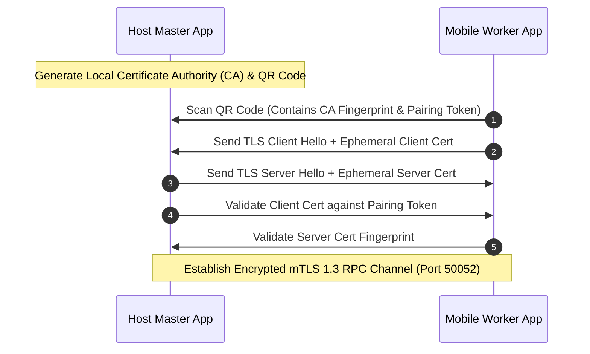

# Security & Threat Model Specification - AI Upcycler

## 1. Security Overview & Philosophy

**AI Upcycler** is built on a **Strict Local-First & Zero-Trust Architecture**. Because prompt contents, activation tensors, and generated outputs travel across local Wi-Fi networks and USB interfaces between devices, securing inter-device transport and local worker sandboxes is critical.

---

## 2. Threat Matrix & Mitigation Strategies

| Threat Vector | Severity | Attack Scenario | Mitigation Strategy |
|---|---|---|---|
| **Local Wi-Fi Eavesdropping** | High | An attacker on the same Wi-Fi network sniffs RPC packets to reconstruct prompt text or tokens. | **mTLS 1.3 Transport Encryption**: All inter-node RPC connections require mutual TLS authentication using ephemeral self-signed certificates. |
| **Rogue Worker Injection** | Medium | A rogue device on the local network registers as a worker node to inject malicious activations or corrupt model outputs. | **Pairing Pin / QR Code Auth**: Pairing requires entering a 6-digit PIN or scanning a cryptographically signed QR code generated by the Master App. |
| **Mobile Device Exploit / Arbitrary Code Execution** | Critical | Malicious model weights or malformed RPC payloads attempt buffer overflows inside the mobile `llama.cpp` RPC C++ runner. | **Mobile App Sandboxing**: Embedded RPC binaries run inside standard Android NDK / iOS App sandboxes without root privileges. Standard size validation on incoming tensor buffers. |
| **Host System Memory Exhaustion (OOM)** | High | Unbounded tensor allocation leads to host kernel panic or browser crash. | **Hard RAM Reservation Guardrails**: Pre-allocates fixed memory pools; rejects layer loading requests exceeding system bounds. |

---

## 3. Mutual TLS (mTLS) Authentication Sequence

**Implementation status (master side):** the ephemeral CA, 6-digit single-use PIN sessions, QR payload (`aiupcycler://pair?fp=…&token=…`), enrollment REST endpoints (`/api/pairing/session`, `/api/pairing/enroll` — `docs/api.md` §3.4), and the mTLS gRPC client (`WorkerRpcClient::connect_tls`) are implemented in `ai-upcycler-core` and covered by end-to-end handshake tests. The distributed split driver dials over it: `LoadedPipeline::load_secure` takes a per-worker `WorkerTransportSource`, requires a client certificate and pins each worker's server certificate to the cluster CA (`core/tests/distributed.rs`). The worker half (Android mTLS server, QR display UI, server-fingerprint validation on-device) awaits the §5 hardware phase.

**Certificate role separation (audit, §6):** one CA signs both the master's server certificate and the worker client certificates, so without an `extendedKeyUsage` pin the two are interchangeable — a certificate issued for `serverAuth` was accepted as a *client* credential, letting the holder of the master's server identity join the cluster as a worker. `NodeCa` now pins `ServerAuth` on the server certificate and `ClientAuth` on issued client certificates, and `core/tests/mtls.rs` covers both directions (`server_cert_is_not_accepted_as_a_client_cert`, `client_rejects_server_cert_from_untrusted_ca`). Client certificates also carry no `subjectAltName`, so they cannot satisfy the hostname check the client enforces on a server certificate — a second, independent barrier.

**Known, accepted gap:** the driver now speaks mTLS (`LoadedPipeline::load_secure`), but mTLS is not yet the *default*: `LoadedPipeline::load` still dials plaintext for loopback/ADB links, and the desktop shell does not drive a live request path yet, so the running master still dials workers over plaintext. Plaintext stays acceptable only on loopback or an ADB tunnel. mTLS becomes the default once the worker's mTLS server exists (§5) and the shell passes a pairing-store-backed `WorkerTransportSource`.

---

## 4. Mobile Agent Sandboxing & Permissions

1. **Android Permission Minimal Scope**:
   - `android.permission.INTERNET`: Required for local network socket binding.
   - `android.permission.ACCESS_WIFI_STATE`: Required for mDNS discovery.
   - `android.permission.REQUEST_IGNORE_BATTERY_OPTIMIZATIONS`: Prompts user to allow background execution during pooling.
   - **No Storage or Contacts Permissions**: The mobile app strictly does not access personal user files or data.
2. **Memory Safety**:
   - Compiles native C++ RPC code with `-fstack-protector-strong`, `ASLR`, and `FORTIFY_SOURCE=2`.
